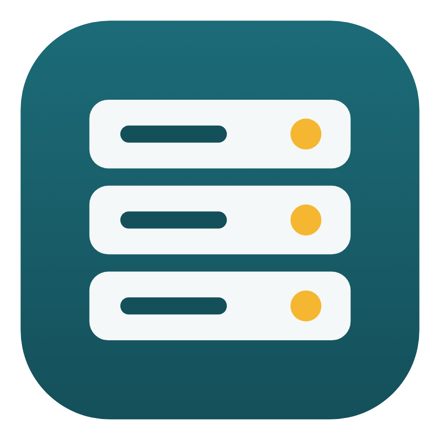

# GoNAS

A self-hosted file server with web, SFTP, FTP/S and WebDAV access, on local disks or cloud storage
(S3, Google Cloud Storage, Azure Blob and more).

- **WebClient:** browse, share and preview files, with two-factor authentication and API keys.
- **WebAdmin:** users, groups, virtual folders, quotas, event rules, IP lists and server settings.
- **REST API:** described in [`openapi`](./openapi).
- A strict Content-Security-Policy works on both web UIs: scripts are plain files with no build step.

See [FORK_FEATURES.md](./FORK_FEATURES.md) for what this fork adds, and [HANDOVER.md](./HANDOVER.md)
for how to build and test it.

## Origin

GoNAS is a modified version of [SFTPGo](https://github.com/drakkan/sftpgo). It is not affiliated with
or endorsed by the SFTPGo project. SFTPGo is a registered trademark of Nicola Murino.

The web UIs of GoNAS were written for this fork and contain none of the proprietary theme that the
SFTPGo web UIs are built on.

## License

GoNAS is licensed under the GNU AGPL-3.0-only with [additional terms](./NOTICE). As the AGPL requires,
every page links to the source code of the running version.

## Copyright

Copyright (C) 2019 - 2026 Nicola Murino

Modifications for GoNAS by their respective authors.
